

# PandaUI

**Rediscover Azeroth. Keep the soul of Vanilla, without the interface friction.**

A complete interface overhaul built for **OctoWoW** (1.12.1 client).

> [!IMPORTANT]
> ## Install PandaUI
> 1. [Download the latest release](https://github.com/Tom75VN/PandaUI/releases/latest/download/PandaUI.zip).
> 2. Extract the archive into `Interface\AddOns\` in your OctoWoW folder.
> 3. Rename the extracted `pandaUI-master` folder to `pandaUI` by removing `-master`.
> 4. Confirm that `pandaUI.toc` is directly inside the `pandaUI` folder, then launch the game or reload the interface.

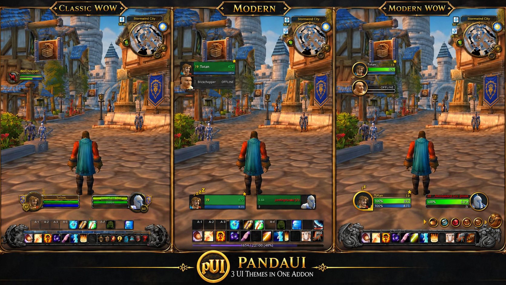

## Three interfaces, one addon

Pick the look you want in the settings; every feature works in all three.

- **Classic WoW**: keep the native interface you know, with all of PandaUI's features.
- **Modern**: a clean, minimalist flat design.
- **Modern WoW**: the look and feel of the Retail interface.

| Classic WoW | Modern | Modern WoW |
|---|---|---|
| 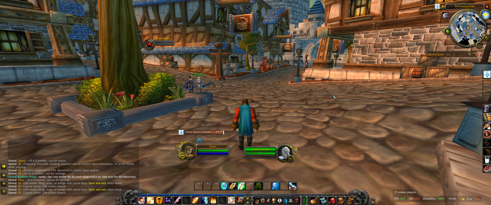 | 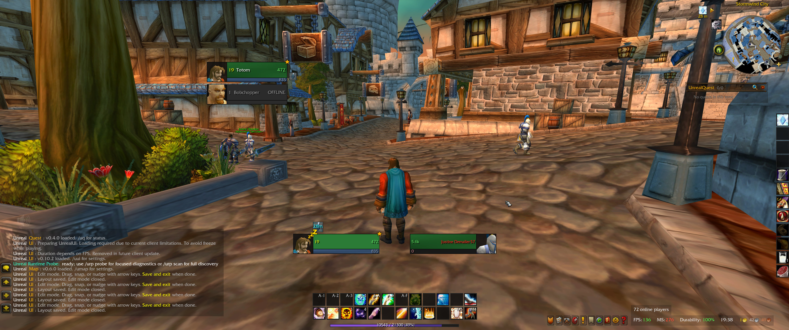 | 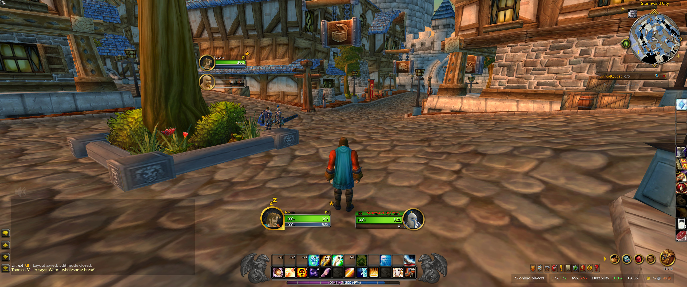 |

## Main features

### Visual Edit Mode

Move any element, snap it to a grid or place it freely. Unit frames, action bars, bags, cast bars, XP and reputation bars, the quest tracker and more all live in one edit mode, and the layout is kept across reloads.

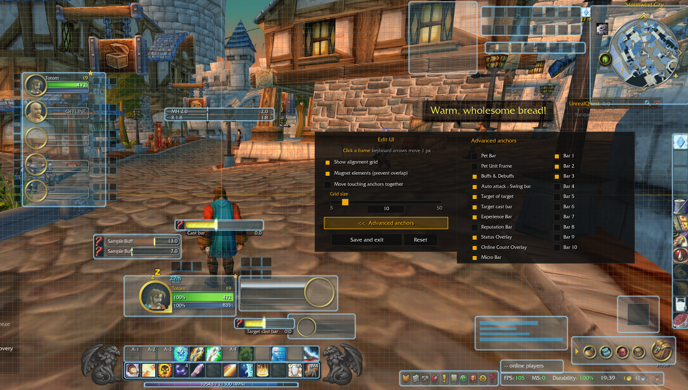

### Quick Binding

Hover an action slot and press a key. No trip through nested menus.

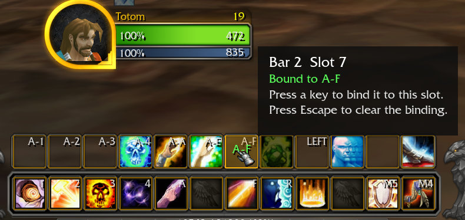

### Settings in one place

PandaUI's options sit inside the game settings window, next to Video, Sound and Interface. Switch theme, toggle features, and open Edit Mode from the same screen. The interface is available in **English, French, Russian and Chinese**.

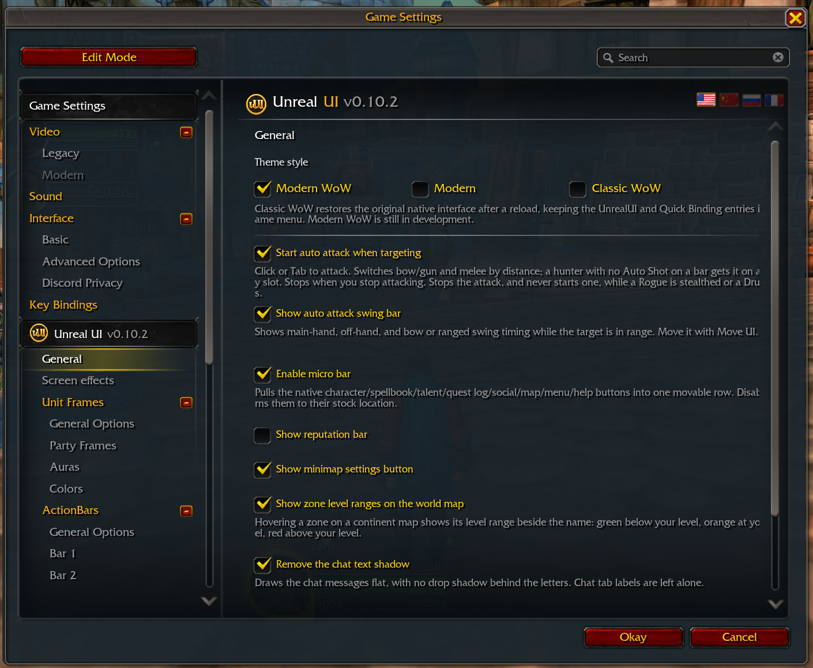

### 10 configurable action bars

Control the number of buttons, rows, size, spacing and cooldown display for each bar.

### Unit frames, nameplates and combat feedback

- Modern unit frames with real enemy HP and mana numbers.
- Nameplates, colour-coded debuffs, a cast bar and a swing timer.
- Party frames with buffs, debuffs, heal prediction and HoT timers.

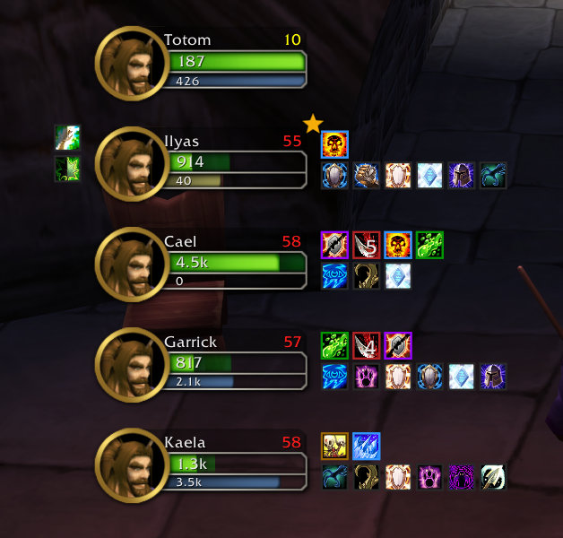

### Raid frames

Up to 8 groups of 5, with class-coloured health, power, heal prediction, your own HoTs, debuffs and dispel highlights.

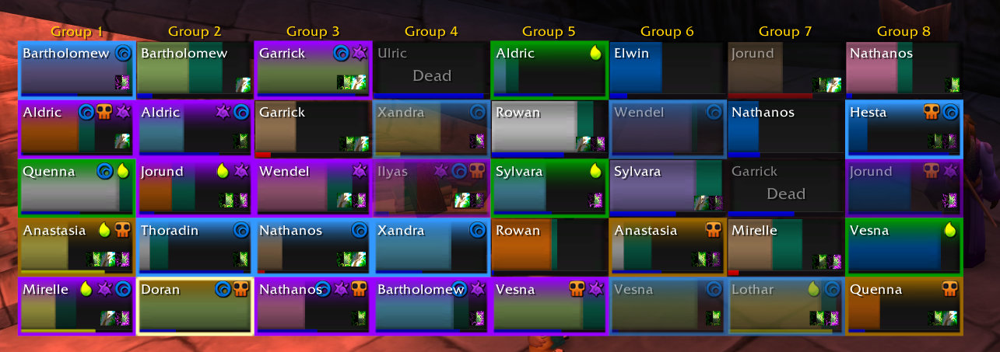

### Restyled windows

Quest Log, Character, Spellbook, Talents, Social and more share one consistent style.

**Character**

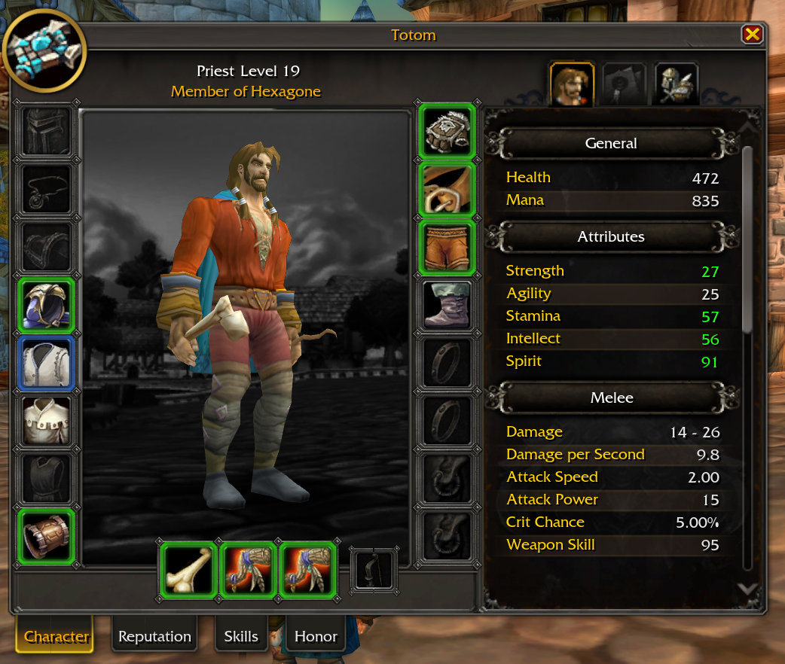

**Spellbook and Professions**

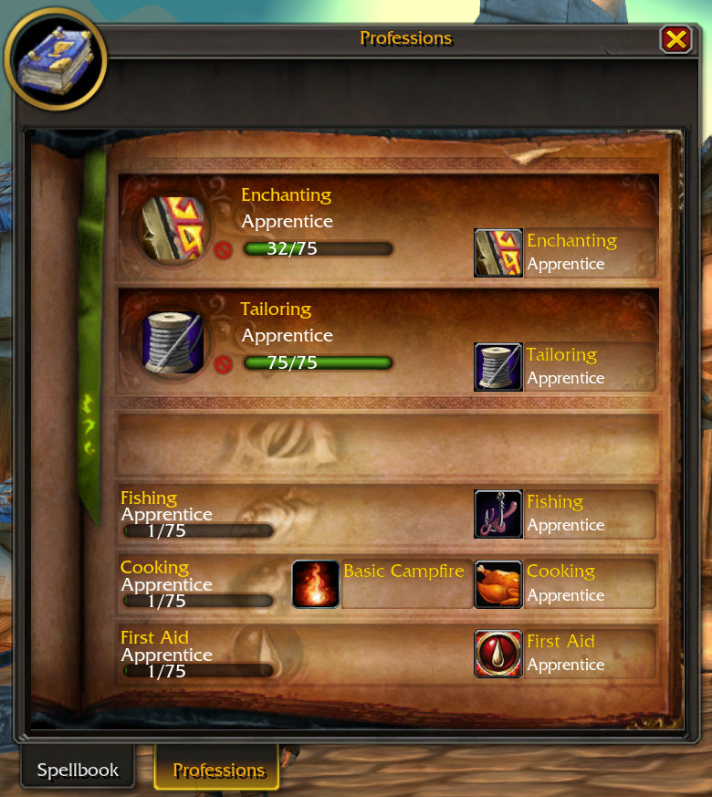

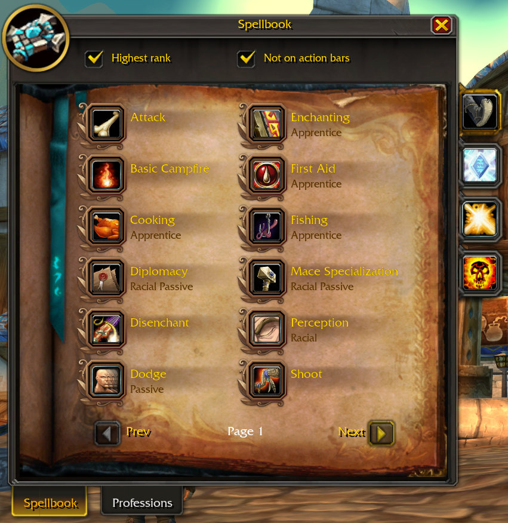

**Crafting** with recipe search, difficulty filter and a recipe tracker you can keep on screen.

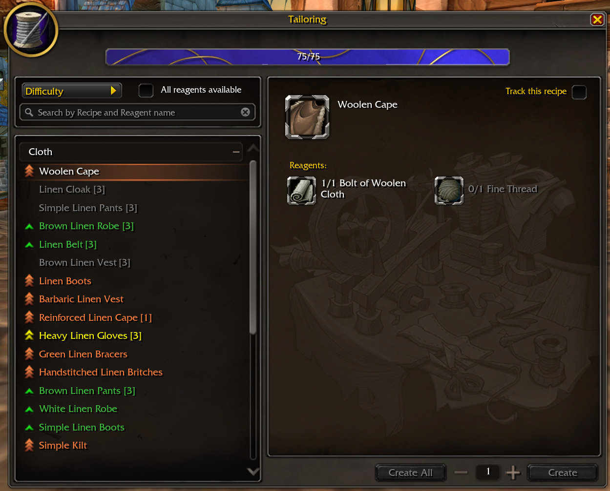

### Talent build advisor and equipment sets

Follow a Leveling, PvP or Raid build: the advisor highlights the talent to pick next and flags points spent outside the build. Save and swap equipment sets from the Character window.

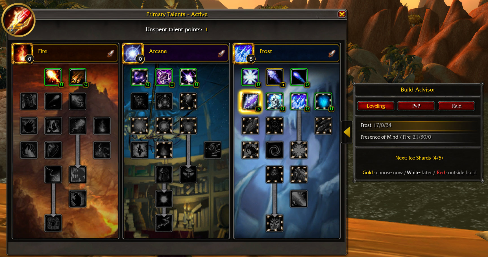

### Bags and bank

A unified bag and bank window with sorting, search and one-click junk selling.

## Extras

- Saved bank, viewable anywhere.
- Item sell prices and item comparison.
- Auto-sorting into specialty bags.
- World map coordinates and zone level ranges.
- XP and reputation bars with rested XP.
- Low-health and loss-of-control screen warnings.
- Profession recipe tracker on screen.

## Get started

Use `/pui` to open the settings, `/pui unlock` to arrange supported elements, `/pui bind` to enter Quick Binding mode, and `/pui help` for the full list.

## Version

Current release: **0.1.0**

## Acknowledgements

PandaUI is a port of [UnrealUI](https://github.com/Tom75VN/UnrealUI) 0.10.2 to the OctoWoW client.

[pfUI](https://github.com/shagu/pfUI) by Eric Mauser (Shagu) is used as a technical and design reference during PandaUI development. pfUI is not bundled with PandaUI.

The Modern WoW theme includes art from DragonflightUI-Reforged and Blizzard UI assets. Sources are listed in the `ATTRIBUTION.md` files under [media/Textures](media/Textures/), and talent build sources in [TALENT_ADVISOR_SOURCES.md](TALENT_ADVISOR_SOURCES.md).

## License

PandaUI's code is distributed under the [MIT License](LICENSE). Third-party and Blizzard art keeps its original ownership, as noted in the attribution files.
